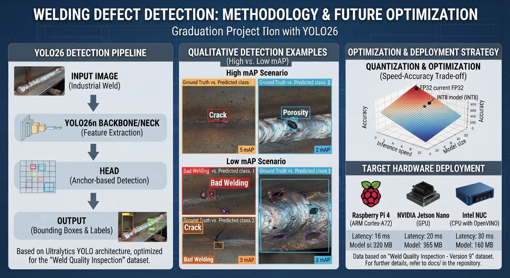
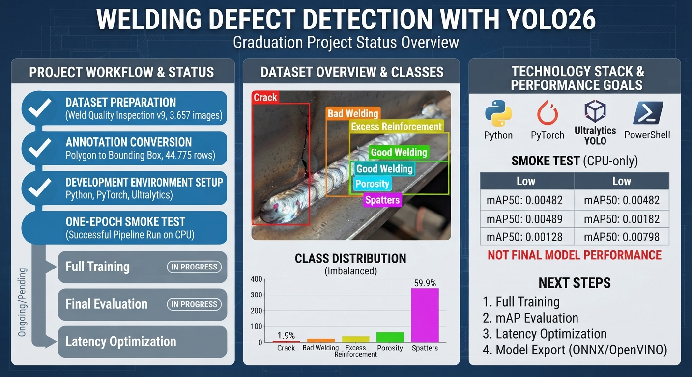

# Welding Defect Detection with YOLO26

> **Graduation project — current status:** dataset preparation, annotation conversion and validation, development-environment setup, and a one-epoch training smoke test have been completed. Full model training and final performance evaluation are still pending.

## Project Overview

This project investigates the detection of welding-quality defects in industrial images using computer vision and deep learning. The intended system uses **object detection**: it should identify the defect category and locate each detected region with a bounding box.

The project has two main goals:

1. Detect and distinguish the welding-related categories represented in the selected dataset.
2. Measure inference latency and investigate suitable optimization methods, then compare accuracy and speed before and after optimization.

Real-time performance will only be claimed if it is demonstrated through measurements on the target hardware.

## Dataset and Classes

The project currently uses **Weld Quality Inspection, Version 9**, published on Roboflow Universe:

- Dataset: [Weld Quality Inspection — Version 9](https://universe.roboflow.com/welding-2bplp/weld-quality-inspection-rei9l/dataset/9)
- Annotation task: Object Detection project export
- License: **CC BY 4.0**. The dataset creator/source must be credited when the dataset is used or redistributed. See [Dataset Attribution and License](docs/09-veri-atfi-ve-lisans.md).

The six class IDs supplied by the dataset are:

| ID | Class name | Meaning |
|---:|---|---|
| 0 | `Bad Welding` | Poor or defective welding |
| 1 | `Crack` | Crack |
| 2 | `Excess Reinforcement` | Excess weld reinforcement |
| 3 | `Good Welding` | Good/normal welding |
| 4 | `Porosity` | Porosity / pores |
| 5 | `Spatters` | Welding spatters |

**Scope note:** `Good Welding` is a normal-quality category rather than a defect category. Its role in the final project scope should be confirmed with the project supervisor. The selected dataset does not contain every possible welding defect type; for example, burn-through and dust/contamination are not among its six classes.

### Dataset Split

The local dataset contains **3,657 images**:

| Split | Images | Label files | Final annotation rows |
|---|---:|---:|---:|
| Train | 3,031 | 3,031 | 40,067 |
| Validation | 421 | 421 | 3,629 |
| Test | 205 | 205 | 1,079 |
| **Total** | **3,657** | **3,657** | **44,775** |

The annotation-row counts above are for the converted and deduplicated detection dataset. They represent object annotations, not the number of images.

### Class Imbalance

The final annotation distribution is imbalanced. `Spatters` represents approximately 60% of all annotation rows, while `Crack` represents approximately 1.9%. This imbalance will be considered when interpreting class-wise precision, recall, and mAP. No balancing or oversampling strategy has been applied yet.

| Class | Final annotation count | Approximate share |
|---|---:|---:|
| Bad Welding | 933 | 2.1% |
| Crack | 861 | 1.9% |
| Excess Reinforcement | 3,901 | 8.7% |
| Good Welding | 1,481 | 3.3% |
| Porosity | 10,777 | 24.1% |
| Spatters | 26,822 | 59.9% |
| **Total** | **44,775** | **100%** |

## Annotation Preparation

The downloaded YOLO-format labels contained a mixture of bounding-box rows and polygon rows. Standard YOLO detection labels contain five values:

```text
class_id x_center y_center width height
```

Polygon annotations contain a class ID followed by normalized coordinate pairs. Since this project currently uses object detection rather than instance segmentation, polygon annotations were converted to their enclosing axis-aligned bounding boxes.

For polygon vertices, the conversion computes:

\[
x_{min}=\min(x_i),\quad x_{max}=\max(x_i)
\]
\[
y_{min}=\min(y_i),\quad y_{max}=\max(y_i)
\]
\[
x_c=\frac{x_{min}+x_{max}}{2},\quad y_c=\frac{y_{min}+y_{max}}{2}
\]
\[
w=x_{max}-x_{min},\quad h=y_{max}-y_{min}
\]

This conversion preserves the approximate location and extent of each annotated region but loses polygon-shape detail. It may produce identical bounding boxes from distinct polygons. An analysis identified 82 such exact duplicate rows across the converted dataset; those duplicates were removed from the converted copy only. The original Roboflow export was not modified, and a backup of the pre-cleaning converted labels was created.

Because bounding boxes can include additional background around thin or irregular defects (especially cracks), visual annotation review remains important. The conversion should not be interpreted as equivalent to segmentation.

## Technology Stack

| Component | Purpose | Version / status used during development |
|---|---|---|
| Python | Data processing and model development | 3.14.3 |
| PyTorch | Deep-learning framework | 2.15.0+cpu |
| TorchVision | Computer-vision utilities | 0.29.2+cpu |
| Ultralytics | YOLO model loading, training and evaluation | 8.4.215 |
| Pillow | Image reading and annotation previews | 12.2.0 checked in system Python; availability in the project virtual environment still needs verification |
| PowerShell | Dataset inspection and Windows automation | Windows |

Development hardware used for the initial smoke test:

- CPU: Intel Core i5-1135G7 (11th Generation)
- RAM: 7.80 GB usable
- Graphics: Intel Iris Xe Graphics
- Training device: CPU (`torch.cuda.is_available()` returned `False`)

The initial experiments use CPU training because the installed PyTorch build is CPU-only and the available graphics hardware is integrated Intel Iris Xe. Training speed may therefore be limited.

## Repository Structure

The GitHub repository is intended to contain source code and documentation, not the full image dataset, local Python virtual environment, or large training artifacts.

```text
welding-defect-object-detection/
├── README.md
├── .gitignore
├── GITHUB_YUKLEME_REHBERI.md
├── docs/                         # Project notes and technical documentation (Turkish)
├── scripts/                      # Dataset and experiment utility scripts
│   └── README.md
└── src/                           # Main application / experiment code (to be added)
```

Dataset folders, backups, the `.venv` directory, model weights, generated previews, and training runs should remain outside version control unless a specific small artifact is intentionally selected for publication. Review `.gitignore` before committing.

## Development Setup

The development environment was created in a separate virtual environment. The following commands summarize the installation used on the development machine; dependency versions should be pinned and re-tested in a clean environment before treating this as a reproducible installation guide.

```powershell
python -m venv .venv
.\.venv\Scripts\python.exe -m pip install --upgrade pip
.\.venv\Scripts\python.exe -m pip install torch torchvision --index-url https://download.pytorch.org/whl/cpu
.\.venv\Scripts\python.exe -m pip install -U ultralytics
```

## Completed Work

- [x] Selected and downloaded the Roboflow Weld Quality Inspection Version 9 dataset.
- [x] Checked train, validation and test image/label filename matching.
- [x] Identified mixed bounding-box and polygon annotations.
- [x] Converted polygon annotations to axis-aligned bounding boxes for detection.
- [x] Validated the converted labels, class IDs, normalized coordinates and box boundaries.
- [x] Analyzed exact duplicate boxes created by polygon-to-box conversion.
- [x] Removed 82 exact duplicate rows from the converted copy and kept a backup of the pre-cleaning labels.
- [x] Reviewed class distribution and generated six example visualizations.
- [x] Installed PyTorch, TorchVision and Ultralytics in a project-specific environment.
- [x] Downloaded and loaded the YOLO26n pretrained weights.
- [x] Completed a one-epoch training smoke test using 2% of the training split, batch size 1 and image size 320.

## Initial Smoke Test (Not a Final Model Result)

The smoke test confirmed that the model, dataset loader and CPU training pipeline could run together. It used only a small fraction of the training data and one epoch; its metrics must **not** be presented as the final model performance.

| Setting | Value |
|---|---:|
| Model | YOLO26n pretrained weights |
| Training fraction | 0.02 (2%) |
| Training images selected | 61 |
| Epochs | 1 |
| Image size | 320 |
| Batch size | 1 |
| Device | CPU |

The smoke-test output reported approximately:

| Metric | Smoke-test value |
|---|---:|
| Precision | 0.343 |
| Recall | 0.0196 |
| mAP50 | 0.00482 |
| mAP50-95 | 0.00183 |
| Inference time | 18.3 ms/image (reported by this run; not a controlled benchmark) |

These values are retained only as a record of the pipeline test. They do not establish that the model has learned the task adequately. The run also performed validation on the full validation split in its final reporting stage.

## Next Steps

- [ ] Confirm the final class scope with the project supervisor, especially the role of `Good Welding` and any missing defect categories.
- [ ] Complete a more detailed visual review of bounding boxes, particularly for thin defects such as cracks.
- [ ] Run a controlled baseline training experiment with documented parameters and reproducible seeds.
- [ ] Evaluate the final model on the held-out test split.
- [ ] Report per-class precision, recall, mAP50 and mAP50-95, together with a confusion matrix and qualitative examples where appropriate.
- [ ] Measure inference latency under a documented hardware and batch-size configuration.
- [ ] Investigate export and optimization options such as ONNX and OpenVINO, then compare model quality, latency and resource usage before and after optimization.
- [ ] Consider class-imbalance strategies only after establishing and reporting a baseline.


## Visual Preview

The following images illustrate the welding inspection project and its visual context.

<p align="center">
  
  
</p>


## Documentation

The detailed development notes are currently maintained in Turkish:

- [01 — Project Aim and Scope](docs/01-proje-amaci-ve-kapsam.md)
- [02 — Dataset and Source](docs/02-veri-seti-ve-kaynak.md)
- [03 — Annotation Conversion](docs/03-etiket-donusumu.md)
- [04 — Data Quality and Validation](docs/04-veri-kalitesi-ve-dogrulama.md)
- [05 — Development Environment and Technologies](docs/05-gelistirme-ortami-ve-teknolojiler.md)
- [06 — Initial Training Experiment](docs/06-ilk-egitim-denemesi.md)
- [07 — Problems and Solutions](docs/07-sorunlar-ve-cozumler.md)
- [08 — Next Steps and Experiment Plan](docs/08-sonraki-adimlar-ve-deney-plani.md)
- [09 — Dataset Attribution and License](docs/09-veri-atfi-ve-lisans.md)
- [GitHub Upload Guide](GITHUB_YUKLEME_REHBERI.md)
- [Scripts Guide](scripts/README.md)

---

**Project status:** Dataset preparation and the initial training-pipeline smoke test are complete. Full training, final test evaluation and inference optimization are ongoing work and have not yet been completed.
